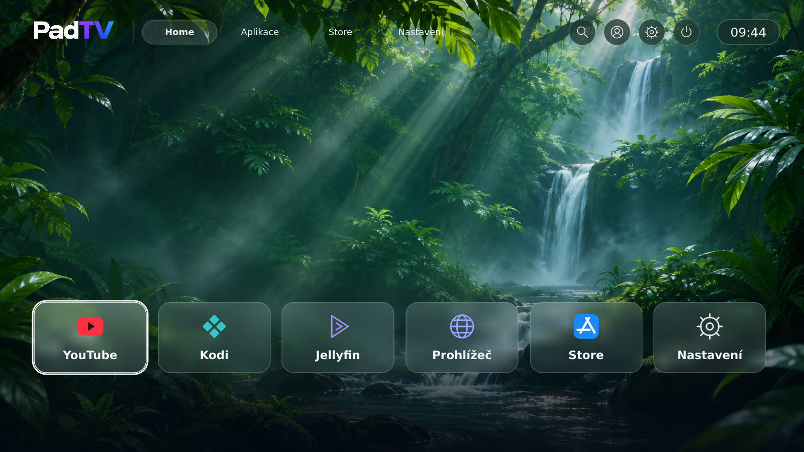

# Ověření PadTV 0.3 – System Core

Datum: 24. listopadu 2026. Vydání OS: **0.3**, verze balíčků: **0.3.2**.
Testovací prostředí: Debian 13 v QEMU/KVM a Windows 11 s QEMU/WHPX.
Výsledky ve virtuálním stroji nejsou potvrzením kompatibility všech fyzických PC.

## Výsledný obraz

- `dist/padtv-0.3-system-core-amd64.iso`, **2 371 092 480 bajtů**.
- SHA-256: `37d5bc1f95a8ea418652fac5db2da411f8d41c2c1179dffae27f46642d7ba02c`.
- Kontrola všech **782 položek MD5 i SHA-256** uvnitř ISO prošla. Windows kopie má shodný SHA-256.
- Python moduly `padtv`, `padtv_core` a `padtv_store` v sestaveném systému odpovídají zdrojům. Zkontrolované jsou také bootovací nabídky, kernel, initramfs a příprava Waydroidu.
- Finální ISO nabootovalo přes UEFI/OVMF v KVM do plochy Liquid Glass. Ve Windows nabootovalo přes BIOS/WHPX s přenesenými uživatelskými daty.
- PadTV používá vlastní `/etc/os-release`, Plymouth a automatickou Wayland relaci labwc/greetd. Běžný start nevyžaduje přihlašovací heslo.

## Automatické a integrační testy

- **93 unit testů prošlo na Windows i Debianu 13.** Ověřují knihovnu aplikací, odstranění YouTube, katalog a poskytovatele Store, navigaci, systémové adaptéry, validaci API a identifikaci oken.
- Schéma katalogu ověřilo všech **13 aplikací**; připravená je také kontrola v GitHub Actions.
- `tests/integration_core.py` prošel nad finálním ISO: identita a inventáře API, restart NetworkManageru, zamítnutí neprivilegovaného účtu, automatický restart zabitého API, restart zabitého UI při zachování otevřeného správce souborů, skutečná změna rozlišení a návrat po 15 sekundách bez potvrzení.
- Samostatný test pádu labwc obnovil jednu aktivní místní Wayland relaci a funkční autorizaci systémového API.
- `tests/integration_wayland.py` ověřil dvě skutečná okna Chromium se shodným titulkem a rozdílnými profily: opakované spuštění bez duplikátu, správný výběr aplikace, obnovení minimalizovaného okna, nalezení okna novou instancí UI a nové otevření zavřené aplikace.
- Hodiny UI za aktivní aplikací zastavují svůj časovač. Blur pozadí se ukládá do mezipaměti, místo opakovaného výpočtu každého snímku.
- `tests/integration_store.py` prošel: sladění skutečných instalací s knihovnou, opakované otevření stejného okna Jellyfinu, přidání/odstranění webové aplikace a skutečné odinstalování VLC z Flathubu.
- Při opakování integračního testu byly opraveny dvě chyby samotného testu: čekání na registraci D-Bus po restartu a opakovatelný úklid již zavřeného testovacího okna. Konečný běh všech kontrol Core prošel.

## Aplikace a Store

- Skutečně staženy a nainstalovány VLC a Jellyfin Desktop z Flathubu jako uživatelské aplikace. Jellyfin Desktop byl spuštěn; odstranění VLC bylo ověřeno přes inventář Flatpaku.
- YouTube zůstává předinstalovanou webovou aplikací s vlastním profilem Chromium. Lze jej odstranit a při dalším startu se neobnovuje. Nejde o předinstalované oficiální Android TV APK.
- Waydroid VANILLA byl připraven a spuštěn s vnořeným Westonem. Ve VM používá software rendering podle doporučení Waydroidu.
- Jellyfin Android TV **0.20.0**: skutečná instalace APK, spuštění TV rozhraní a odinstalování s běžným potvrzením Androidu prošly. Přehrávání z uživatelova Jellyfin serveru testované nebylo.
- APT poskytuje inventář systémových aplikací. GitHub a komunitní repozitář jsou připravené rozšiřující body, zatím nejsou aktivní zdroje stahování.
- Google Play, certifikace Google TV, ARM překlad a garance přehrávání DRM nejsou implementované. Kompatibilita dalších APK se musí ověřovat jednotlivě.

## Instalace a data

- Grafická instalace Calamares na vyhrazený prázdný **48GB virtuální disk** prošla v režimu BIOS i UEFI. Obě instalace následně nabootovaly z disku bez Live média.
- BIOS test proběhl na kandidátním sestavení s opravou konfigurace mount; stejná oprava je ve finálním balíčku. UEFI test proběhl na kandidátu RC6 se stejnou konfigurací instalátoru jako finální ISO.
- UEFI instalace vytvořila ESP a kořenový oddíl; následný start otevřel nové rozhraní bez přihlašovacího dialogu. Účet `padtv` má v instalaci zamčené heslo a odstraněné Live pravidlo sudo bez hesla. Samostatný správcovský účet zůstává pro údržbu.
- Oprava Exo zahrnuje shodnou verzi `libexo-2-0`, `libexo-common` i `exo-utils`, aby se nenarušily závislosti APT.
- Původní Windows disk `virtual-machines/PadTV-0.3/padtv.qcow2` zůstal zachovaný. Přenos proběhl z jeho kopie připojené pouze ke čtení do nového úložiště `PadTV-0.3-System-Core`.
- Přeneseny byly uživatelské domovy a dostupná data Waydroidu a NetworkManageru. Starý systémový overlay `/ union` se nepřenesl. Nová šablona `padtv-persistence-v2-64G.qcow2` uchovává jen určené datové adresáře.

## Napájení a omezení virtualizace

- Vypnutí přes systémové API bylo ověřeno skutečným ukončením VM. ACPI vypnutí fungovalo také po instalaci na disk a ve Windows.
- Restart přes API v čerstvé Live relaci dokončil nový start: změnil se kernel boot ID, znovu běžely PadTV i API a žádná systémová služba nebyla ve stavu failed. Následné vypnutí přes API ukončilo VM.
- **Spánek není zatím spolehlivě ověřený.** Uspání přes logind proběhne, ale po S3 ve VirtIO GPU zůstává černý obraz. Jde o chování popsané také v [upstream QEMU](https://gitlab.com/qemu-project/qemu/-/issues/2520).
- Vypnutí S3/S4 v konfiguraci Windows VM přepíná dostupný spánek na s2idle. V KVM se při něm vrátil obraz i API, avšak navazující testy virtuálních zařízení nebyly stabilní. Nelze to označit za plně funkční uspání/probuzení. Pro spolehlivý test této verze používejte vypnutí a nový start.
- Na tomto Windows/WHPX hostiteli způsobovala původní konfigurace startovní prodlevy až zatuhnutí. Konfigurace `q35,hpet=off` se čtyřmi CPU nabootovala do PadTV; prošel i opakovaný start běžným spouštěčem bez diagnostických rozhraní. Nejde o měření výkonu na fyzickém PC. Při diagnostice bylo nutné několik neodpovídajících VM ukončit nuceně; původní disk i kopie dat zůstaly zachované.

## Co ještě vyžaduje fyzické zařízení nebo další práci

- Konkrétní Wi-Fi a Bluetooth čipy, skutečné HDMI audio, 4K, hardwarové dekódování, ovladače GPU a probuzení dálkovým ovladačem.
- Secure Boot a HDMI-CEC nejsou ověřené; vlastní CEC integrace zatím není implementovaná.
- Nové Core zachovává adaptéry NetworkManager/BlueZ/PipeWire. Starší testy virtuální Wi-Fi a Bluetooth jsou v [protokolu 0.3](validation-0.3.md); nebyly opakovány na každém fyzickém adaptéru ani vydávány za takové ověření.
- Instalátor nebyl spuštěn proti fyzickému disku uživatele. Rozdělení disku, dual boot, šifrování a obnova po výpadku napájení potřebují další testy.
- Organizace GitHub a veřejné repozitáře dosud neexistují. Připravených je pět lokálních exportů a kontrolovaný publikační skript. Web, vzdálený katalog a automatický aktualizátor OS nejsou nasazené.
