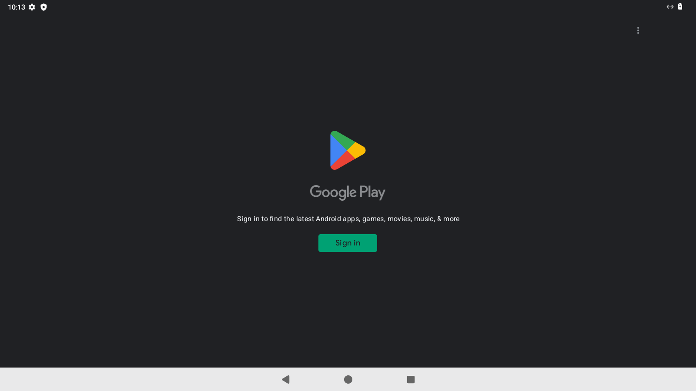
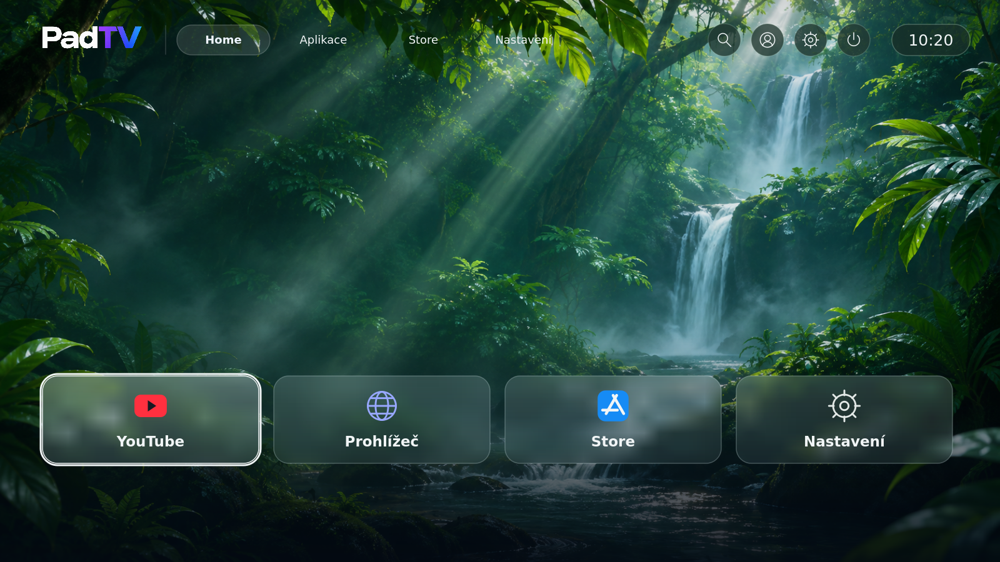

# Ověření PadTV 0.3 – System Core, balíčky 0.3.3

Datum: 24. listopadu 2026. Základ: Debian 13 amd64.
Předchozí testy jádra systému a instalátoru jsou zachované v
[protokolu 0.3.2](validation-0.3.2.md). Následující výsledky se týkají změn 0.3.3.

## Automatické kontroly

- **108 unit testů prošlo na Windows a Debianu 13.** Zahrnují katalog Google Play,
  validaci identifikátorů, skutečné versus neznámé inventáře, zachování webového
  YouTube, odstranění aplikací a převod starších APK záznamů bez duplicit.
- JSON Schema ověřilo všech **13 položek katalogu**. Kontrola ShellCheck obou
  hlavních build skriptů prošla. Všechny tři Debian balíčky se sestavily.
- Opravena chyba sestavení po testech: adresář `__pycache__` se nesmí kopírovat
  jako soubor modulu instalátoru. Výběr je nyní explicitní.
- Opraven reprodukovaný pád Qt na Linuxu při zániku okna během odpovědi Store.
  Signály procesu používají metody navázané na životnost Qt objektu.

## Google Play ve skutečné VM

- Oficiální Waydroid VANILLA byl převeden na **GAPPS** pomocí pevně určených
  OTA adres Waydroidu. Systémový obraz byl skutečně stažen a Google Play
  (`com.android.vending`) se objevil v inventáři spuštěného Androidu.
- Google Play se otevřel na přihlašovací obrazovce. Žádný účet Google nebyl
  do testovací VM přihlášen.
- `tests/integration_google_play.py` prošel nad skutečným Qt rozhraním a
  poskytovatelem Store: otevření požadavků pro `com.google.android.youtube.tv`
  a `com.netflix.ninja`, žádné nepravdivé označení za nainstalované, zachovaný
  předinstalovaný webový YouTube. Test používal stejný upravený modul Store,
  který je ve výsledném ISO.
- **Samotné stažení obou TV aplikací, přihlášení a přehrávání zatím ověřené nejsou.**
  Vyžadují uživatelský účet a dostupnost aplikace pro konkrétní zařízení.
  Netflix DRM ani přehrávání ve 4K nejsou potvrzené.
- Registrace Android ID u Google podle dokumentace Waydroidu není certifikací
  Google TV ani certifikací Netflixu. PadTV žádné neoficiální APK nezrcadlí.

## Výsledné ISO a virtuální PC

- Soubor: `dist/padtv-0.3.3-amd64.iso`, **2 335 375 360 bajtů**.
- SHA-256: `3cabe3c204686391e982351aeb6fc63a66bda4d31df1795b22481eb0d5d2ba21`.
- Kodi není nainstalovaný systémový balíček. Kodi a Jellyfin nejsou ve výchozí
  nabídce ani v katalogu. Ručně nainstalovaná uživatelská data se hromadně nemažou.
- Kontrola všech **782 položek MD5 i SHA-256** uvnitř finálního ISO prošla.
  Windows kopie má shodný SHA-256. Instalované Python moduly, bootovací nabídky,
  kernel, initramfs a pomocník Androidu odpovídají výsledným zdrojům.
- Finální ISO nabootovalo přes **UEFI/OVMF** s čerstvou pamětí firmwaru a bez
  připojeného dříve instalovaného systémového disku. Hybridní BIOS bootloader
  je zachovaný; Windows test kandidáta používal BIOS.
- Kandidát 0.3.3 nabootoval do rozhraní na Windows/WHPX s původním datovým diskem.
  Finální obraz obsahuje navíc opravu životnosti procesu Store a migraci manifestů.
  Běžící Windows VM se během práce nemusí ukončovat: její konfigurace načte nový
  obraz při příštím vypnutí a novém spuštění přes zástupce.

## Rozsah a omezení

Instalátor BIOS/UEFI, obnovení systémových služeb, vypnutí a restart byly prakticky
ověřené při vydání 0.3.2; zde se jejich implementace neměnila a úplná instalace
na disk se znovu neprováděla. Dřívější výsledky nejsou nové testy této verze.

Fyzické Wi-Fi, Bluetooth, HDMI audio, GPU akcelerace, HDMI-CEC a Secure Boot
potřebují další ověření. Spánek ve VM není spolehlivý; pro testování používejte
vypnutí a nový start. Automatický aktualizátor OS, veřejný web a podepsaný
komunitní zdroj aplikací nejsou nasazené. Veřejné zdrojové repozitáře samy
o sobě neaktivují vzdálené aktualizace systému.
