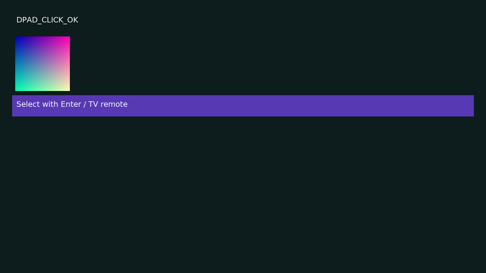
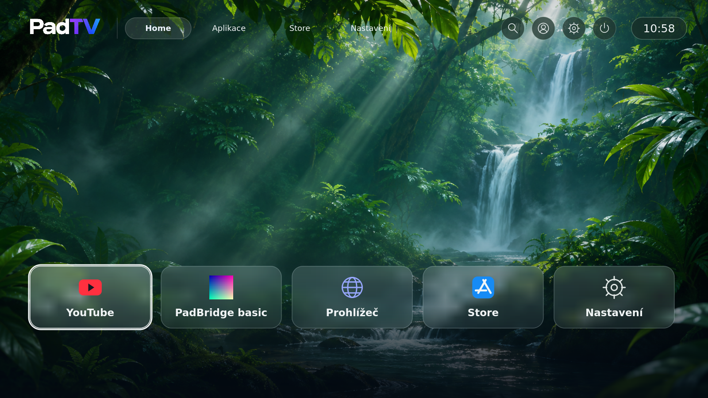

# Ověření PadTV 0.4 – Android Compatibility

Datum: 24. listopadu 2026. Základ: Debian 13 amd64.
PadTV 0.4.0 obsahuje PadBridge 0.1.0, experimentální začátek samostatného projektu.
Číslo PadTV není prohlášením o dokončení milníku PadBridge 0.4 nebo 1.0.

## Automatické testy a běh APK

- **111 testů PadTV prošlo na Windows a Debianu 13**: všech původních 108
  zachovaných + 3 nové pro integraci PadBridge, oddělení runtime a oficiální katalog.
- **6 Rust unit testů** a **14 integračních testů s vlastními podepsanými APK**.
  Integrační testy běží jako běžný uživatel ve skutečné VM s povinným bubblewrap.
- Ověřené podpisy, zachování originálního APK, odmítnutí změněných dat, jiného
  podepisovatele, nižší verze i poškozených metadat. Aktualizace zachová data;
  odinstalace je může zachovat nebo odstranit.
- DEX 035 → JVM skutečně vykonal výpočet, lifecycle Activity, obsluhu tlačítka,
  práci se soubory, síťový požadavek s povolením a jeho zamítnutí bez oprávnění.
  Test ověřil izolaci hostitelských cest a omezenou obnovu po pádu.
- Samostatný test ověřil APK pouze s Leanback launcherem. Diagnostika čte
  architekturu ELF a požadované knihovny; nativní Android knihovny zatím nespouští.
- Ve Waylandu se skutečně zobrazil text a obrázek z APK. Virtuální klávesnice
  vyvolala Android OnClickListener a změnila text. To není test fyzického TV ovladače.
- AudioTrack a MediaCodec testy ověřují **nepodporovanou funkci**, nikoliv přehrávání.
- Sestavily se čtyři Debian balíčky; hlavní build skripty prošly ShellCheck.

## ISO, Store a instalátor

- ISO: `dist/padtv-0.4.0-amd64.iso`, **2 435 448 832 bajtů**.
- SHA-256: `e91c06eda724ff0759c7ae3f42838bcf0e75f61f7e67095dad9bde63c753b9da`.
- Ověřeno všech **782 položek MD5 i SHA-256** uvnitř ISO a shoda Windows kopie.
  Systémové Python moduly, PadBridge binární soubor, framework JAR, JNI knihovna,
  překladač, bootovací nabídky, kernel a initramfs odpovídají sestavení.
- Skutečný **UEFI/OVMF start z ISO**, s čistými firmware proměnnými a prázdným
  instalačním diskem; `/sys/firmware/efi` přítomné, BUILD_ID 0.4.0.
- Ve skutečném UI: **Store → Ukázka PadBridge → Instalovat**, vlastní název a ikona,
  záznam v knihovně, spuštění přímo z Home do Wayland okna.
- Zástupce Windows aktualizovaný na **PadTV 0.4 Android Compatibility – virtuální PC**.
  Zachovává původní `padtv.qcow2`; běžící VM používá starý obraz až do vypnutí a
  nového spuštění. Náhled `PadTV.lnk` zůstává dostupný.
- Grafický instalátor úspěšně dokončil **novou UEFI instalaci na 48GB QCOW2 disk**:
  GPT, 512MB EFI oddíl a ext4 kořen. Calamares oznámil `completion: succeeded`.
  Na cíli ověřeny PadTV 0.4.0 a PadBridge 0.1.0. Původní testovací i uživatelské
  disky zůstaly zachované.
- Nově instalovaný disk úspěšně nabootoval přes UEFI **bez ISO i bez Live datového
  disku**. Automaticky se otevřel PadTV; televizní účet nevyžadoval heslo.
- Finální ISO nabootovalo také přes **BIOS/SeaBIOS** do Home s dříve nainstalovaným
  APK z perzistence. Nepoužil se přímý kernel boot ani dříve instalovaný OS disk.

## Rozsah a omezení

PadBridge nepoužívá Waydroid ani Android systém. Backend je Enjarify/OpenJDK,
nikoliv ART. Implementace obsahuje omezené Android API, vlastní Rust JNI a SDL2
Wayland grafiku; plný framework, Bionic, Binder, ARM64, EGL/Vulkan a média zůstávají
dalšími milníky. [Seznam API](https://github.com/PadTVos/PadBridge/blob/main/docs/api.md) a
[architektura](https://github.com/PadTVos/PadBridge/blob/main/docs/architecture.md) rozlišují aktuální a plánované části.

YouTube TV a Netflix zůstávají v katalogu s oficiálním Google Play. Není získané
originální APK z přihlášeného oprávněného účtu a jejich běh v PadBridge nebyl
ověřen. Otevření Google Play není instalace. Waydroid zůstává samostatnou zálohou
se zachovanými daty; nedochází k automatické migraci ani hromadnému mazání.
Předinstalovaný webový YouTube je nadále normálně odinstalovatelný.

Widevine/L1, HDCP enforcement, bezpečná video cesta a certifikace Netflixu nejsou
implementované. [Secure Media Engine](https://github.com/PadTVos/PadBridge/blob/main/docs/secure-media.md) je návrh
integrace s licenčními a hardwarovými požadavky. Firmware SecureBoot flag není
důkazem integrity celého systému. Sandbox je experimentální, bez dokončeného
bezpečnostního auditu a plného omezení spotřeby prostředků.

Fyzické Wi-Fi, Bluetooth, HDMI audio, CEC, hardwarové video a další GPU vyžadují
testování na zařízení. Spánek ve VM zůstává neověřený. Změny jádra nastavení,
síťových služeb a Waydroidu nebyly součástí této iterace.
