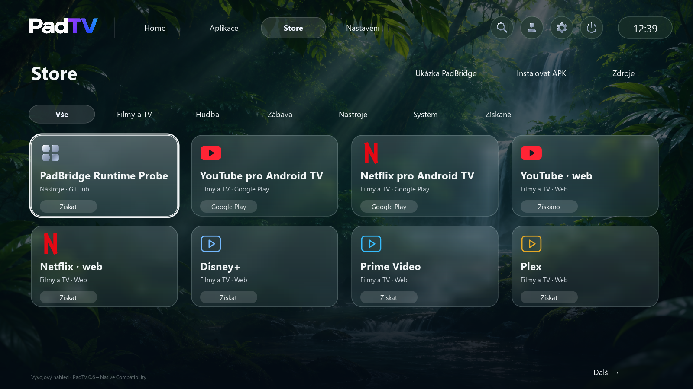
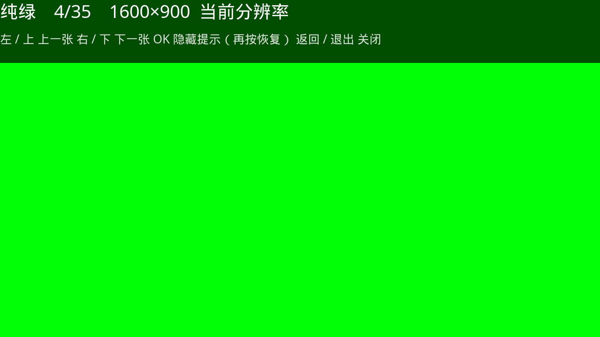
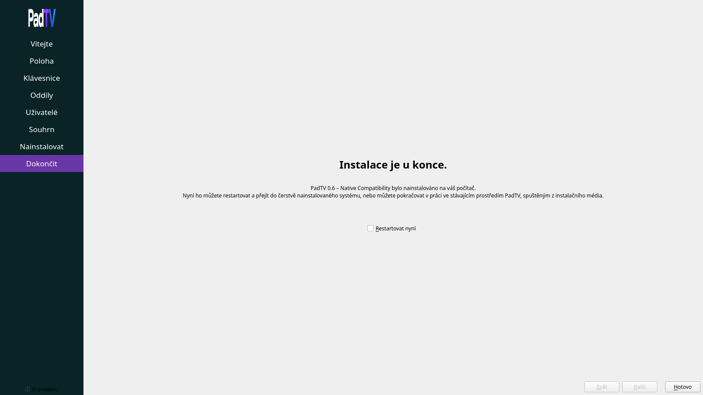
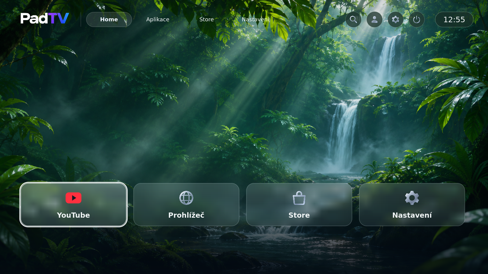

# PadTV 0.6 – Native Compatibility / PadBridge 0.3

Datum ověření: 2026-11-24. Experimentální vydání. Nová funkcionalita není obecná
kompatibilita Android TV ani certifikace Google/Netflix.

## Automatické testy

167 testů prošlo; všech původních 145 testů zůstalo zachovaných.

| Sada | Počet | Prostředí |
|---|---:|---|
| PadTV Python | 120 | Windows, včetně 6 nových testů GitHub provideru a kontroly vypnutého Waydroidu |
| Rust core + JNI host | 7 | Debian 13 |
| Původní APK/sandbox integrační testy | 14 | Debian 13 v KVM, skutečný bubblewrap |
| Java/Kotlin/multidex/SQLite/FFmpeg 0.5 | 11 | Debian 13 v KVM |
| Native JNI/APKM/analyzátor | 7 | Debian 13 v KVM |
| Poškozený DEX a hranice instrukcí | 5 | Windows a Debian 13 |
| Neupravené cizí TV APK, pixely a vstup | 3 | Debian 13 v KVM, Waydroid vypnutý |

## Skutečné aplikace

| Aplikace | Instalace | Spuštění a GUI | Omezení |
|---|---|---|---|
| Screen Test 4K 1.0.1, LuoJuly | Ano, původní podepsané APK | Ano: Canvas/Wayland, šipky, zelená plocha, šachovnice, skrytí ovládání | Zbylé režimy a fyzické 4K zařízení neověřené |
| Launch on Boot 1.1.1 | Ano | Ne | Nyní chybí skutečné Animation API v podpůrném FragmentHostCallback |
| TVBro | Ano | Ne | JVM odmítá překlad konstruktoru; následně chybí části AppCompat a WebView |
| YouTube TV 7.30.301, uživatelem dodané APK | Ano | Ne | 32bitové x86 ELF, Bionic/systémové knihovny, GMS/DRM neimplementované |
| Netflix TV 13.2.4, uživatelem dodané APKM | Ano, ověřená split sada | Ne | ARMv7 ELF, Bionic a DRM neimplementované |

Soukromé APK nejsou zveřejněné. Kryptografické ověření podpisu balíčku samo o sobě
nepotvrzuje jeho původ od Google/Netflix. Údaje o GMS a DRM rozlišují statické
odkazy a neověřenou potřebu za běhu.

[Veřejná databáze a JSON/HTML reporty](https://github.com/PadTVos/PadBridge/tree/main/compatibility/0.3)
obsahují hashe, otisky podpisů, chybějící signatury, ELF závislosti a pozorované
výjimky. APK třetí strany se pro automatický test stahuje přímo z připnutého
commitu autora, bez úprav a bez zahrnutí do ISO.

## Store a Windows

Ověřeno skutečné stažení Runtime Probe z GitHub Releases, hash a podpis,
instalace, vykonání původního DEX, XML tlačítko, odinstalace a zachování dat.
Windows náhled zachovává rozhraní a nové ikony. Finální ISO nastartovalo přes
SeaBIOS/QEMU/WHPX až do Home bez přihlášení. Uživatelský virtuální disk se
neformátoval; Windows test použil samostatný prázdný 32GB disk.

## Hranice vydání

ART není spustitelný backend. Bionic/Android linker/TLS, ARM překlad, Chromium
WebView, úplný Android framework a Android audio/video API zůstávají nehotové.
Funguje úzký freestanding x86-64 ELF/JNI podmnožinový běh v sandboxu. Canvas je
CPU renderer; hardwarovou akceleraci nebo 4K přehrávání toto vydání nepotvrzuje.
Widevine, chráněné video a certifikace nejsou implementované.

Fyzické Wi-Fi/Bluetooth čipy, uspání/probuzení, HDMI-CEC, HDR, HDCP, audio passthrough,
fyzický ovladač a konkrétní GPU vyžadují hardwarové testy. BIOS/UEFI ve VM takové
zkoušky nenahrazují. Přesný stav a další kroky jednotlivých modulů jsou v
[implementačních hranicích PadBridge 0.3](https://github.com/PadTVos/PadBridge/blob/main/docs/runtime-0.3.md).

## Instalace a start z disku

Finální ISO bylo spuštěné přes OVMF/UEFI v KVM. Calamares vytvořil na novém
48GB testovacím disku GPT, 512MiB FAT32 EFI oddíl a ext4 systémový oddíl.
Instalace skončila `completion: succeeded`. Následný start z instalovaného disku
proběhl **bez ISO a bez připojeného 64GB perzistentního disku**, až do PadTV Home
s automatickým přihlášením. Původní perzistentní data zůstala zachovaná.
Samostatný start finálního ISO ve Windows přes WHPX/SeaBIOS také prošel.
Při inventarizaci v čistém finálním Live systému zůstal Waydroid `inactive`.

## Výsledný obraz

`padtv-0.6.0-amd64.iso` · 2442657792 bajtů.

SHA-256: `dc990e71dd2390820085aae0482e1bc07ee3865ca2ecb2f40a67076999c98e03`.

Ověřeno všech 782 záznamů MD5 a 782 záznamů SHA-256 uvnitř ISO,
bootovací nabídky, jádro a initramfs. Obsah SquashFS odpovídá sestaveným
modulům, ikonám, PadBridge, jádru i initramfs (71 kontrolovaných souborů).
SHA-256 kopie ve Windows odpovídá sestavenému ISO.

Na ploše je nový zástupce **PadTV 0.6 Native Compatibility – virtuální PC**.
Používá původní virtuální disk a nové ISO. Dříve otevřenou VM je potřeba ukončit
a spustit znovu; její běžící proces automaticky nepřepíná připojené médium.

[Testovací vydání na GitHubu](https://github.com/PadTVos/PadTV-OS/releases/tag/v0.6.0)
obsahuje ISO rozdělené do dvou částí. `Join-PadTV.ps1` zkontroluje jejich hashe,
spojí je a ověří celé ISO. Složení ve Windows bylo ověřené proti výše uvedenému
SHA-256. Třetí strany APK ani soukromé klíče nejsou distribuované.
