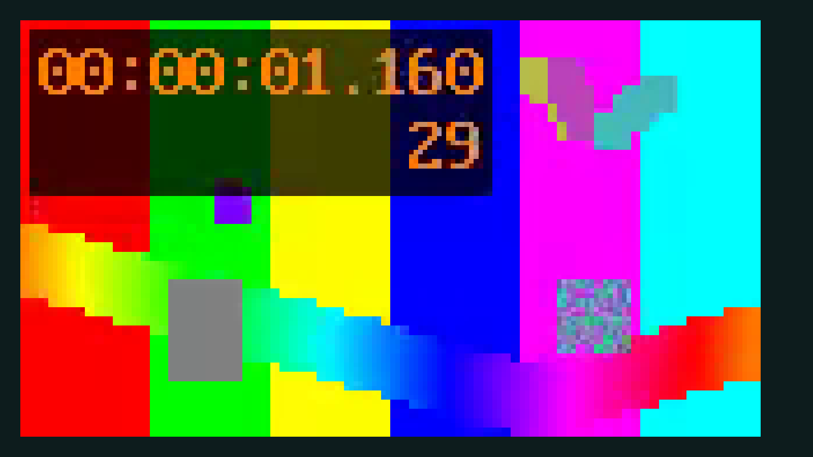
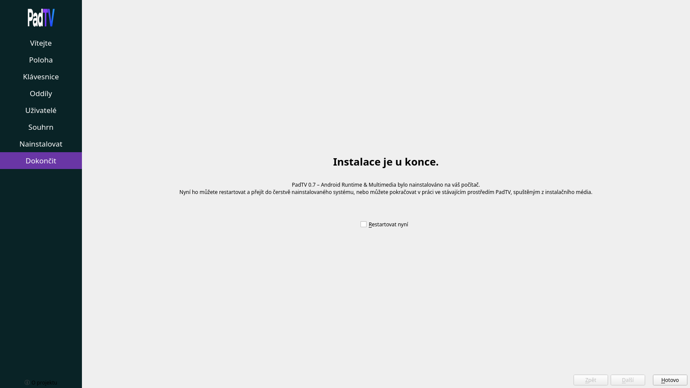
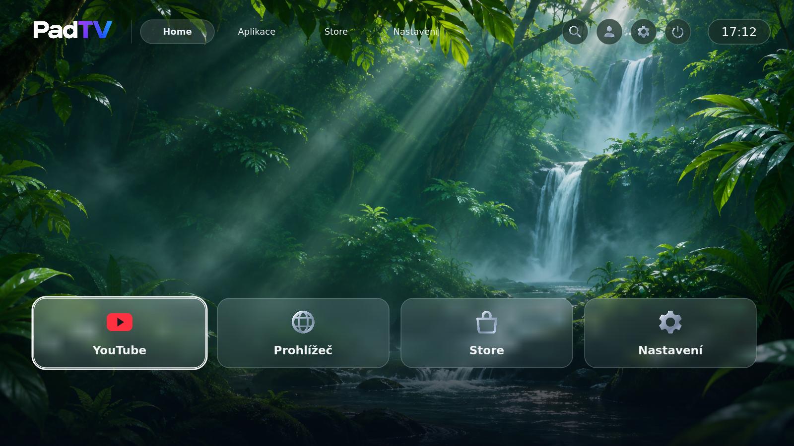

# Ověření PadTV 0.7 / PadBridge 0.4

Datum: **27. listopadu 2026**. Experimentální vydání pro Debian 13 amd64.
**Hlavní cíl přehrávání v originálním Jellyfin Android TV zatím splněný není.**
Nové multimediální API skutečně dekóduje a přehrává testovací video a zvuk;
Jellyfin, YouTube a Netflix stále blokuje neúplná kompatibilita Androidu.

## Automatické testy

**189 úspěšných testů: 167 původních + 22 nových. Žádný test nebyl přeskočen.**
Porovnání názvů testů s předchozím vydáním zachovalo všech 160 původních
Python testů a sedm Rust testů. Čtyři očekávání starších testů byla upravena:
MediaCodec nově skutečně vytvoří dekodér; nepoužitá nepodporovaná nativní
knihovna neblokuje Java kód; AudioTrack je implementovaný, ale původně volaná
metoda výstupního zařízení stále chybí; katalog nově uvádí pozorované selhání
místo pouhého „neověřeno“. Původní testovací APK nebyla nahrazena jednoduššími.

| Sada | Počet | Prostředí |
|---|---:|---|
| PadTV a Store | 120 | Windows, PyQt6 offscreen |
| Rust | 7 | Debian 13, `cargo test --workspace --locked` |
| Původní podepsané APK | 14 | KVM guest, běžný účet, povinný bubblewrap |
| Runtime 0.2 | 11 | stejný guest |
| Runtime 0.3 | 7 | stejný guest |
| Analyzátor | 5 | stejný guest |
| Originální Screen Test 4K | 3 | původní APK, pixely a D-pad |
| Resources 0.4 | 4 | platná i poškozená binární data |
| Zvukový broker 0.4 | 2 | odmítnutí nepovolených operací a příliš velkých paketů |
| Runtime 0.4 | 6 | JNI/ELF, konstruktorový řetězec DEX, výjimky, lifecycle, EGL/GLES |
| Multimedia/WebView/HTTPS 0.4 | 10 | skutečné FFmpeg, Chromium a zvukový server |

Integrační guest používá Debian 13 / základ PadTV 0.6 s novými binárními
komponentami PadBridge 0.4 a doplněnými testovacími závislostmi. BIOS/UEFI a
instalace byly navíc provedeny se skutečným ISO PadTV 0.7. Testy neoslabují
sandbox a Waydroid během Android testů neběžel.

CI běží v Debian 13 kontejneru na Ubuntu hostu. Chromium dostává pouze cílené
oprávnění AppArmor vytvořit vlastní user namespace podle
[postupu upstream Chromium](https://chromium.googlesource.com/chromium/src/+/main/docs/security/apparmor-userns-restrictions.md).
Chromium sandbox i bubblewrap zůstávají zapnuté; nepoužívá se `--no-sandbox`.
Test zvuku ověřuje skutečný PulseAudio server, místní VM PipeWire-pulse.

## Skutečně ověřené nové funkce

- Originální DEX volá MediaExtractor a MediaCodec: celé H.264 video, AAC,
  PTS a konec streamu; 30 RGBA snímků odpovídá referenčnímu FFmpeg výstupu.
- AudioTrack posílá PCM přes omezený broker do skutečného linuxového zvukového
  serveru. Monitor testovacího výstupu zachytil signál 440 Hz. Nejde o test
  fyzických reproduktorů nebo HDMI.
- MediaPlayer vykreslí SurfaceView a dokončí video se zvukem. Ověřena pauza,
  změna pozice a opakované spuštění. Klip má **160×90, 1,2 sekundy**; neprokazuje
  4K, hardwarovou akceleraci ani dlouhodobou synchronizaci.
- Skutečný EGL kontext a GLES shader vytvoří trojúhelník; ověřeny výsledné pixely.
- Chromium WebView vykoná JavaScript původního APK, změní DOM a vykreslí
  očekávané pixely. Nejde o webovou náhradu Jellyfin, YouTube nebo Netflix.
- HTTPS ověřuje důvěru certifikátu a název serveru. Přidání/odebrání veřejné CA
  platí pro konkrétní aplikaci. Test ověřuje izolaci druhé aplikace, integritu
  metadat, zachování při odinstalaci bez smazání dat a explicitní smazání.
- Originální Android x86-64 ELF volá JNI RegisterNatives a omezené paměťové ABI.
  Nepodporovanou knihovnu skutečné volání nenačte. Není to plný Bionic/linker.

## Originální aplikace

| Aplikace | Instalace | Spuštění / GUI / přehrávání | První pozorovaná překážka |
|---|---|---|---|
| Jellyfin Android TV 0.20.1 | ano, ověřen podpis | ne / ne / ne | `android.view.ViewTreeObserver$OnGlobalLayoutListener` při původním `Application.attachBaseContext` |
| YouTube TV 7.30.301 | ano, ověřen podpis | ne / ne / ne | `android.view.ViewGroup$MarginLayoutParams` v původním Application |
| Netflix 13.2.4, APKM | ano, ověřeny split podpisy | ne / ne / ne | překlad Enjarify překročí 16bitový rozsah JVM tabulky výjimek |
| Screen Test 4K 1.0.1 | ano | ano / ano / neaplikuje se | originální Canvas, bitmapová šachovnice, šipky a OK fungují |

Jellyfin pochází z [oficiálního upstream vydání](https://github.com/jellyfin/jellyfin-androidtv/releases/tag/v0.20.1).
SHA-256 původního APK: `5a9ec1d489b542eafc6fe628278f6aa2c077fd1b15f8f9b7da1924b52566111c`.
YouTube a Netflix jsou nezměněné uživatelem dodané soubory APKMirror. Kontrola
podpisu prokazuje integritu a identitu podpisu, nikoli nezávislé potvrzení
oprávnění distributora. APK, APKM ani odvozené JAR se nezveřejňují.

Diagnostika Jellyfin našla 613 chybějících tříd a 1122 metod; YouTube 752/1756;
Netflix 595/1795. Jsou to **statické odkazy**, nikoli počet chyb skutečně
vykonaných cest. Kompletní seznamy API, nativních symbolů, podpisů a pozorovaných
výjimek jsou v [záznamech PadBridge 0.4](https://github.com/PadTVos/PadBridge/tree/main/compatibility/reports-0.4).
Jellyfin obsahuje nepodporované nativní závislosti; dodaný YouTube vyžaduje x86-32
a Netflix ARMv7. GMS odkazy byly nalezeny v YouTube/Netflix, v Jellyfin nikoli.
DRM odkazy samy neznamenají, že Jellyfin potřebuje DRM pro vlastní nechráněný obsah.
Widevine, Google Play Services a certifikované zabezpečené přehrávání nejsou hotové.

## ART a zbývající práce

Debianí libart se podařilo načíst včetně závislostí a skutečně zavolat
`JNI_CreateJavaVM`. Výsledek je `-1`, bez vytvořené VM: chybí odpovídající
libcore/boot DEX a boot image. ART backend zůstává nedostupný; nevydává se za
funkční runtime. Záznam je v `PadBridge/compatibility/reports-0.4/art-probe.json`.

Další práce pro Jellyfin: obecný ViewTreeObserver navázaný na skutečné layout
události, kompletnější framework a témata, AndroidX/Compose/Leanback, potřebná
nativní ABI a teprve potom připojení k serveru a skutečné přehrávání. Pro Netflix
je nutné nejdříve vyřešit JVM limit v překladu nebo funkční ART. Přidání prázdných
tříd, vypnutí ověřování bytecode nebo nahrazení aplikace webem není řešení.
Podrobné hranice každého modulu: [PadBridge 0.4](https://github.com/PadTVos/PadBridge/blob/main/docs/runtime-0.4.md).

## Systém, ISO a Windows

Ověřeno: automatický start V6 bez přihlašovacího hesla, Plymouth, UEFI/KVM,
BIOS/Windows WHPX, grafický Calamares na novém 48 GiB testovacím disku, GPT/ESP,
instalace a následný start z disku **bez připojeného ISO**. Fyzické disky Windows
nebyly virtuálním strojům předané. Windows náhled a jeho navigační testy fungují.
Zástupce virtuálního PC ukazuje na 0.7; původní uživatelský qcow2 zůstává zachovaný.

Finální ISO: `padtv-0.7.0-amd64.iso`, **2 445 017 088 bajtů**.
SHA-256: `58860a4ce0c1d666319387b1c269af469f500eb7703c63dc03839a872e5a99ec`.
Ověřeno 782 MD5 a 782 SHA-256 záznamů, bootovací nabídky, kernel/initramfs,
79 souborů instalovaného runtime proti SquashFS a kontrolní součet kopie Windows.
Instalace byla provedena na kandidátu `8941aeab8d3ae7fdfd2dde0b37e717802c89e47f043a933deadbeda4527d61b6`;
finální sestava doplňuje přesnější texty katalogu a diagnostiky. Instalační
komponenty a runtime mají stejný zdroj; finální ISO má samostatně ověřený boot.

Nevyzkoušeno na fyzickém zařízení: Wi-Fi/Bluetooth adaptéry, HDMI audio,
hardwarová VA-API/GPU akcelerace, CEC, HDR, suspend/resume, Secure Boot a 4K.
Nejde o stabilní Android TV distribuci ani o certifikované streamovací zařízení.
