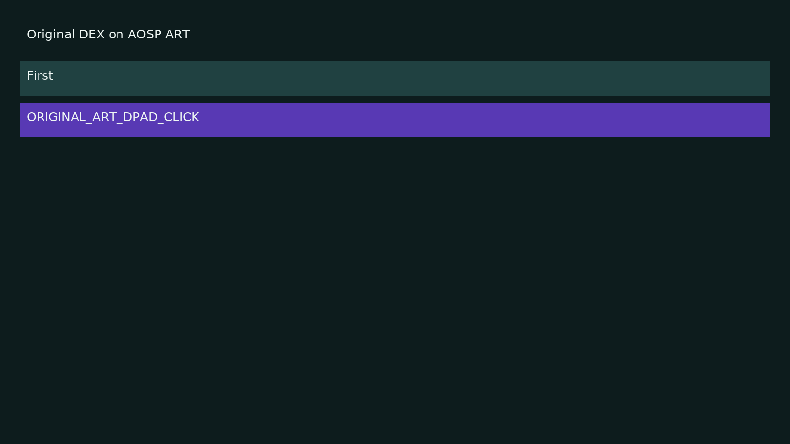
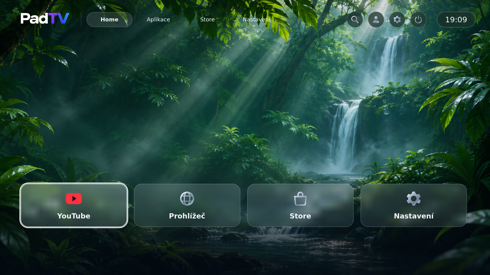
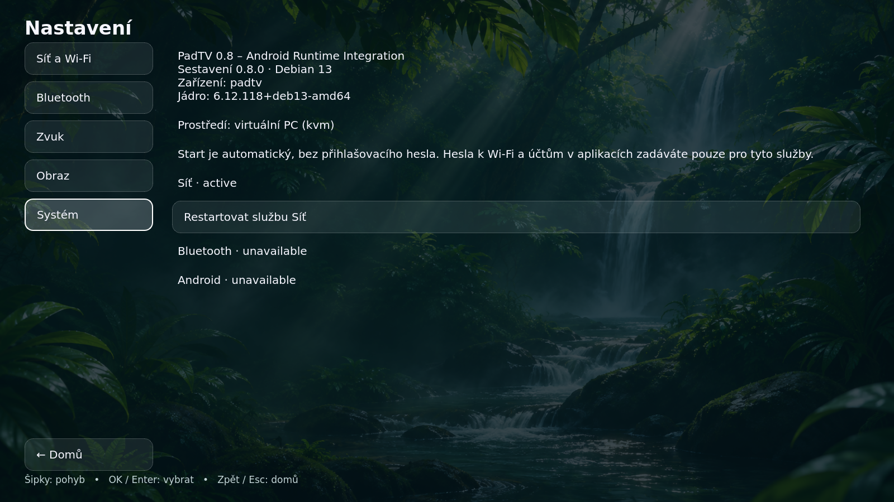

# Ověření PadTV 0.8 / PadBridge 0.5

Datum: **27. listopadu 2026**. Experimentální Debian 13 amd64.
**Hlavní milník není splněný: originální Jellyfin Android TV 0.20.1 zatím
nezobrazí své rozhraní a nepřehrává obsah.** Skutečně funkční novinkou je
integrace AOSP ART, nikoli dokončená kompatibilita Android TV.

## Co nyní opravdu funguje

`padbridge setup-art` stáhne přímo z upstream R8 ověřený AOSP ART 16 host
runtime, odpovídající libcore, boot DEX, ICU a časová data. V sandboxu sestaví
boot image a teprve po úspěšném JNI/DEX testu instalaci aktivuje.
**`JNI_CreateJavaVM` vrací 0.** Samotná přítomnost `libart.so` ani dřívější
neúspěšný Debian probe nejsou považované za připravený runtime.

Použitý [oficiální host build a jeho provenance](https://r8.googlesource.com/r8/+/f8ff923130e5da6265c9e246ba0be5b7acd2396d/tools/linux/README.art-versions)
jsou pevně verzované. Vlastní sestavení AOSP ze zdrojů bylo prozkoumané,
ale nebylo dokončené. Binární archiv ART se nezveřejňuje znovu v PadTV release
a **není uvnitř ISO**. První aktivace potřebuje internet, stažení 591 MB
a přibližně 2 GB volného místa. Podporovaný je i totožný archiv dodaný offline.

ART přímo načítá původní APK/split DEX, bez překladu Enjarify a bez úprav APK.
Podepsané testovací aplikace ověřují původní Java/Kotlin kód, multidex,
split loading, reflexi, výjimky, vlákna a soukromé soubory. Nativní widgetová
scéna se skutečně zobrazila přes Wayland; stisky Dolů a Enter změnily text
v původním DEX a zapsaly soubor `ORIGINAL_ART_DPAD_CLICK`.

To je naše testovací APK, **nikoliv Jellyfin**. Enjarify zůstává výchozím
alternativním backendem. Správa aplikací umožňuje vybrat backend pro konkrétní
aplikaci a stáhnout ART; obnovování katalogu výběr zachová. Automatické skryté
přepnutí backendu při chybě se nepoužívá.

## Framework a izolace

- ViewTreeObserver skutečně doručuje layout, pre-draw, draw, scroll, focus,
  attachment a window události. Pre-draw umí zrušit vykreslení.
- MarginLayoutParams, RTL směrové okraje, rodičovské vazby, skutečné rozměry,
  padding a posun; zpracování stisknutí/uvolnění kláves a kontextové nabídky.
- Kompilované styly, dědičnost témat, typed resources a TypedArray; nejde
  o úplnou Android measure/layout ani všechna systémová resources.
- ContentProvider se inicializují před Application.onCreate, podle initOrder,
  v příslušném procesu, s typovanými manifest metadata a jednou instancí.
- BaseBundle, vybrané Parcelable/Parcel operace, Context.getMainLooper,
  skutečné Log API a omezené soukromé Trace záznamy při explicitním zapnutí.
- Převzaté původní AOSP TypedValue, MathUtils, FontScaleConverter, Size,
  SizeF, TvContentRating a vybrané TextUtils/Preconditions mají evidované
  zdroje a licence. SDK stuby nejsou použité jako runtime implementace.
- Povinný bubblewrap, soukromé adresáře aplikací, explicitní síťové oprávnění,
  kontrola podpisů APK a integrity runtime zůstávají zachované. ART nemá
  neizolovanou náhradní cestu. Waydroid ani virtualizovaný Android se nespouští.

Diagnostika zapisuje fáze identity APK, backendu, integrity, DEX/native
přípravy, sandboxu a ukončení. Lifecycle zprávy z aplikace jsou odděleně
označené jako nedůvěryhodný výstup aplikace. Při chybě ještě před vytvořením
procesu může starý textový log zůstat na disku; rozhodující je aktuální
startup JSON. Ve zveřejněných výsledcích Netflix/Enjarify se starý ART log
z tohoto důvodu nepřipisuje novému pokusu.

## Originální aplikace

Instalace a kryptografická kontrola podpisů prošla u všech tří aplikací.
Oba backendy byly spuštěné samostatně. GUI, navigace a přehrávání u těchto
aplikací **nebyly dosaženy**.

| Aplikace | AOSP ART: pozorované selhání | Enjarify: pozorované selhání |
|---|---|---|
| Jellyfin Android TV 0.20.1 | `providers.initialize`: chybí `Choreographer` v AndroidX ProfileInstaller; při jiném pořadí initializerů také `UiModeManager` v Koin | `application.attach`: chybí `android.graphics.Typeface` |
| YouTube TV 7.30.301 | `application.attach`: chybí `Application.getProcessName()` | `application.construct`: chybí `ParcelFileDescriptor` |
| Netflix 13.2.4, APKM | `application.construct`: chybí `ServiceConnection` | `dex.prepare`: Enjarify překročí 16bitový rozsah JVM tabulky výjimek |

Jellyfin přes ART opravdu vykonal ACRA inicializaci, AndroidX Startup a vlastní
LogInitializer. Dříve chybějící ViewTreeObserver byl doplněný obecnou
implementací. Správné pořadí lifecycle nyní odhaluje chybějící AndroidX
závislosti ještě před Activity; neskrýváme je přeskočením providerů.

Jellyfin APK pochází z [oficiálního vydání 0.20.1](https://github.com/jellyfin/jellyfin-androidtv/releases/tag/v0.20.1).
SHA-256: `5a9ec1d489b542eafc6fe628278f6aa2c077fd1b15f8f9b7da1924b52566111c`.
YouTube a Netflix jsou původní uživatelem dodané soubory APKMirror;
ověření jejich podpisů není nezávislým potvrzením oprávnění distributora.
Tyto APK/APKM ani odvozené JAR nejsou součástí veřejných repozitářů a release.

[Úplné reporty včetně hashů, podpisů, fází a statických ELF/API nálezů](https://github.com/PadTVos/PadBridge/tree/main/compatibility/reports-0.5)
rozlišují statické odkazy od skutečně pozorovaných chyb. Výskyt DRM/GMS odkazu
sám o sobě neprokazuje, že jej konkrétní cesta přehrávání potřebuje.

**Připojení Jellyfin ke skutečnému serveru, video, zvuk, pauza, posun, titulky
a delší 1080p obsah nebyly ověřeny**, protože aplikace nedošla k původnímu UI.
Další kroky: Choreographer napojený na skutečný frame scheduling,
UiModeManager a systémové služby, úplnější AndroidX/resources/layout,
ART kompatibilní grafická a multimediální cesta a nativní závislosti aplikace.
Teprve potom má smysl provést end-to-end test s reálným serverem a delším videem.

## Rozdíly mezi backendy a zbývající překážky

| Oblast | Ověřený stav |
|---|---|
| ART/libcore/boot image | x86-64 host build, JNI návrat 0, původní DEX a nativní widgety |
| Canvas/Bitmap/Paint, SQLite | dosavadní Java2D/JDBC cesta funguje přes OpenJDK; na ART není přenesená |
| MediaCodec/Extractor/Player, AudioTrack, EGL/GLES | dosavadní integrační testy FFmpeg, linuxového zvuku a Mesa znovu prošly přes Enjarify; neprokazují ART/Jellyfin přehrávání |
| WebView a HTTPS/CA | znovu ověřené přes Enjarify; ART cesta není ověřená |
| Bionic/linker/JNI | zachovaný omezený x86-64 ABI; ART host JNI používá glibc, nikoliv plný Android linker |
| x86-32 | původní dalvikvm32 selhal před VM: chybí ELF interpreter `/lib/ld-linux.so.2`; potřeba celého odpovídajícího 32bitového prostředí |
| ARMv7/ARM64 | překlad není implementovaný |
| AndroidX/Compose/Leanback | částečné API, kompletní kompatibilita není dosažená |
| DRM/GMS | Widevine, zabezpečená cesta, Google služby ani certifikace nejsou implementované |

Původní AOSP framework není samostatný zaměnitelný JAR: potřebuje nativní
metody, Binder služby, správu balíčků/resources, grafické buffery a procesní
prostředí. Pouhé vytvoření VM tyto části nenahradí. Podrobnosti a další
omezení jsou v [dokumentaci PadBridge 0.5](https://github.com/PadTVos/PadBridge/blob/main/docs/runtime-0.5.md).

## Testy a zachování původních funkcí

**219 testů prošlo, žádný nebyl přeskočen: všech 189 původních + 30 nových.**
Porovnání s OS revizí `87d1ef1972a29853070e95c8679b46a68ae2705c` potvrzuje
zachování identit i těl původních testů. Logo, pozadí a ikony V6: 33 původních
vizuálních souborů je obsahově totožných.

| Sada | Počet |
|---|---:|
| Windows PadTV/Store, PyQt6 offscreen | 122 |
| Rust | 7 |
| Dosavadní Linux integrační sady | 62 |
| Nové binární resources | 3 |
| Nové Framework regresní testy | 14 |
| Nové ART integrační testy | 11 |

Linux runtime testy proběhly v Debian 13 KVM guestu se základním ISO 0.7,
novými binárními komponentami 0.5 a testovacími závislostmi. Finální ISO 0.8
bylo ověřované samostatně. Historický test nepřipraveného ART používá explicitně
neexistující runtime adresář; následná ART sada testuje skutečně připravený runtime.
Zachovaný CI host Ubuntu 22.04 s Debian 13 kontejnerem nevyžaduje oslabení
AppArmor, bubblewrap ani Chromium sandboxu.

[Počty a výsledky sad](evidence-0.8/test-counts.json),
[porovnání původních testů](evidence-0.8/test-retention.json),
[porovnání vizuálních souborů](evidence-0.8/visual-retention.json).
Počet úspěšných testů není důkaz dokončené kompatibility Jellyfin.

## ISO a fyzická zařízení

Finální obraz `padtv-0.8.0-amd64.iso` má 2 445 017 088 bajtů a SHA-256
`fb5b4a812b64f6aa95a5520f71a0fbcb7b832c734cae145b53da5d6a6b49dd20`.
Ověřené jsou všechny 782 položky obou kontrolních manifestů a shoda
nainstalovaného runtime s výsledkem sestavení.

- BIOS live boot do PadTV: KVM i Windows QEMU/WHPX.
- UEFI live boot do PadTV: KVM/OVMF, výchozí boot z ISO.
- Grafický Calamares: dokončená instalace z tohoto přesného ISO na prázdný
  48GB virtuální disk, GPT/EFI + ext4. Následný UEFI boot bez připojeného ISO
  naběhl automaticky do PadTV 0.8 bez přihlašovacího dialogu.
- Fyzický počítač/TV, Wi-Fi, Bluetooth, HDMI audio, suspend a akcelerované
  dlouhé 1080p/4K přehrávání na skutečném GPU zůstávají neověřené.

Původní uživatelský virtuální disk se při QA nepoužívá. Náhled ve Windows
zůstává vývojovým rozhraním; Android runtime se vykonává v Linuxu.
Aktualizovaný zástupce virtuálního PC používá nové ISO a dosavadní disk;
SHA-256 tohoto uživatelského disku před a po změně konfigurace je totožný.
Spojení obou distribučních částí ISO pomocí Join-PadTV.ps1 bylo provedeno
a výsledný SHA-256 odpovídá výše uvedenému obrazu.
